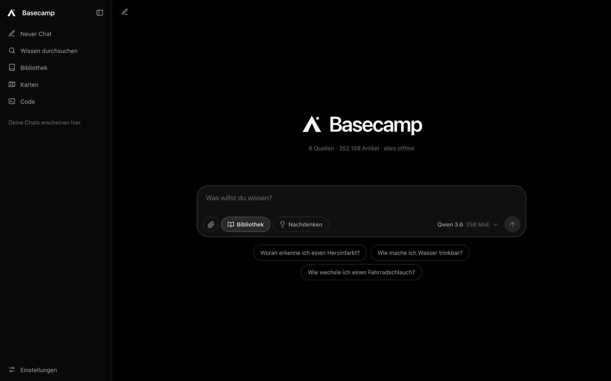
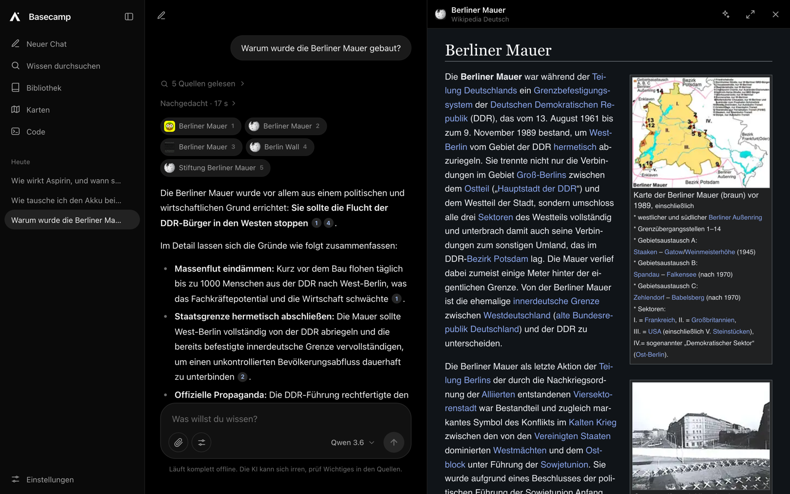
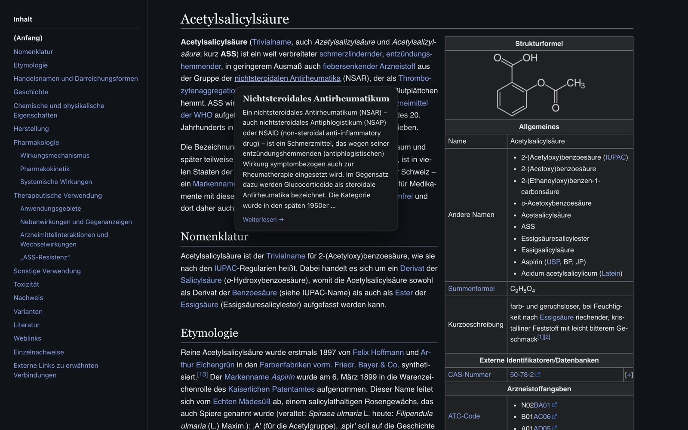
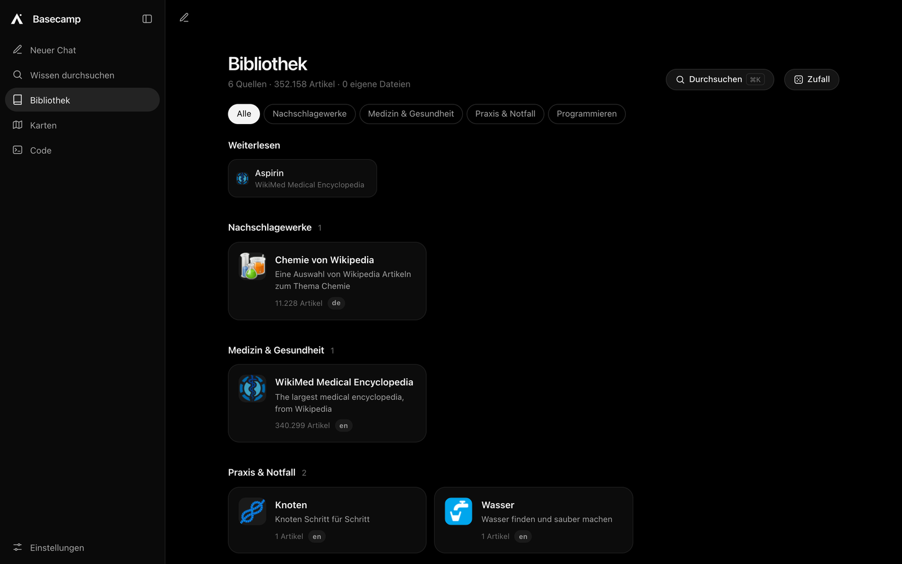
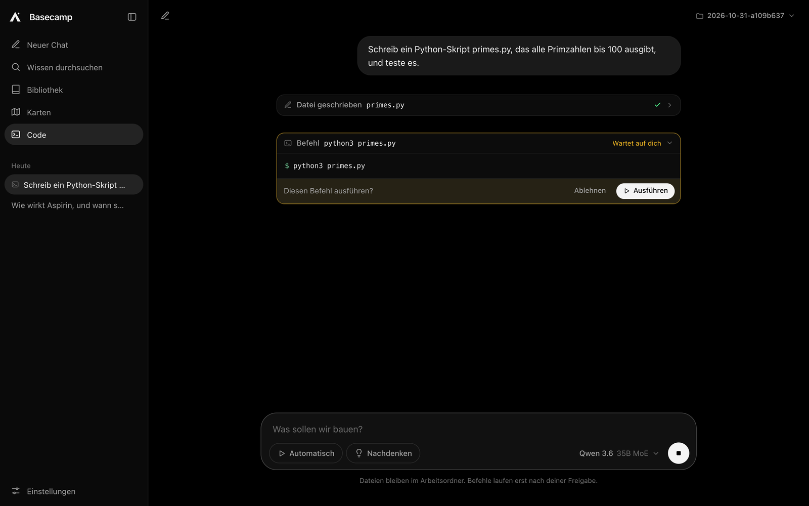
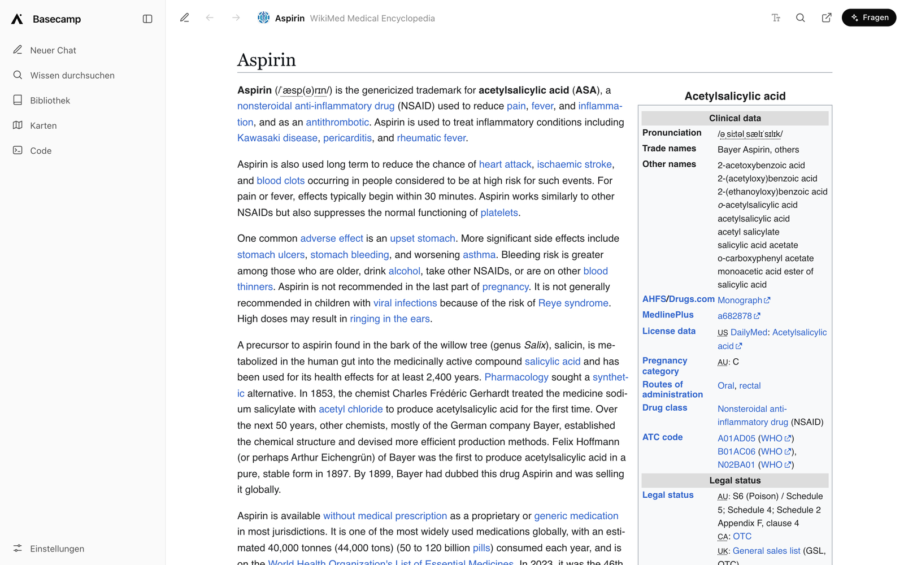
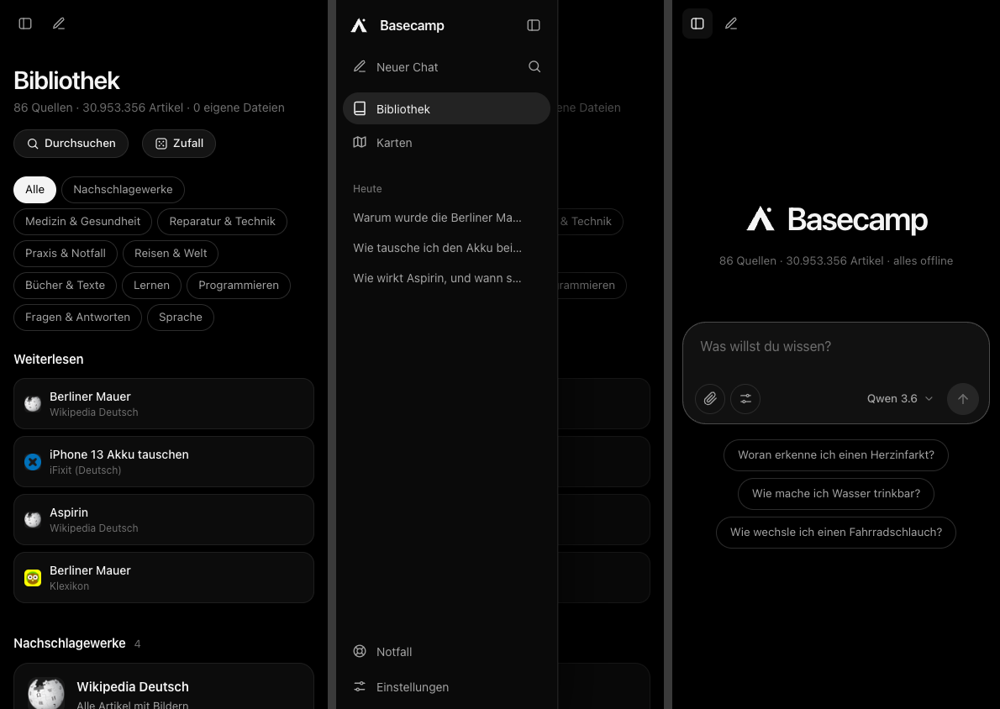

# Project Basecamp

**Offline knowledge and local AI for your Mac.** Wikipedia, medical encyclopedia, repair guides, books, maps and a coding agent in one calm interface. Everything runs on your machine, without internet. It also fits on a USB stick and runs from there on any Mac. The UI is German first.

Offline-Wissen und lokale KI für den Mac. Wikipedia, WikiMed, iFixit, Bücher, Karten und ein Coding-Agent in einer Oberfläche. Nach dem Einrichten läuft alles ohne Internet, auch komplett vom USB-Stick.



## Was es kann

- Chat mit Quellen: Antworten aus deiner eigenen Bibliothek, mit Zitaten [1], [2]. Ein Klick öffnet den Artikel daneben.
- Gedächtnis: Basecamp merkt sich, was du über dich erzählst, und nutzt es in späteren Chats. Du siehst unter jeder Antwort, was neu dazukam, und kannst alles ändern oder löschen.
- Projekte: Eigene Anweisungen, eigene Chats und ein eigenes Gedächtnis je Projekt. Kein Projekt sieht die Fakten eines anderen.
- Lesen wie im Original: Wikipedia mit Inhaltsverzeichnis, Link-Vorschau beim Drüberfahren, Nachtmodus und Textgröße.
- ⌘K-Suche: Titel, Volltext, Orte und eigene Dateien. Auch nur in einer Quelle.
- Karten: Offline-Karten mit deutscher Beschriftung und Ortssuche.
- Code: Ein Agent schreibt und testet Skripte in einem eigenen Ordner. Befehle laufen erst nach deiner Freigabe.
- USB-Stick: Ein Befehl packt App, KI-Modelle und hunderte GB Wissen auf einen Stick. Läuft auf jedem Mac, ohne Installation.

| Chat mit Quellen | Link-Vorschau |
|---|---|
|  |  |

| Bibliothek | Code-Agent mit Freigabe |
|---|---|
|  |  |

| Hell | Handy (im WLAN) |
|---|---|
|  |  |

## Start

Voraussetzung: macOS 14 oder neuer. Apple Silicon empfohlen, auf Intel läuft die KI langsam.

```bash
git clone https://github.com/antonwiep/project-basecamp.git basecamp
cd basecamp
./basecamp setup          # Python-Umgebung, Ollama, pmtiles
./basecamp start          # startet alles und öffnet http://127.0.0.1:4774
./basecamp models         # lädt das passende KI-Modell für diesen Mac
./basecamp download M     # Inhaltspaket laden (S, M, L oder X)
```

Inhalte lassen sich auch im Browser laden: Einstellungen > Inhalte.

## Alles auf einen USB-Stick

Für unterwegs oder als Backup, falls der eigene Rechner ausfällt.

```bash
./basecamp usb /Volumes/STICK                 # zeigt den Plan, fragt, dann geht es los
./basecamp usb /Volumes/STICK --status        # Fortschritt der Downloads
./basecamp usb /Volumes/STICK --max-gb 400    # nur einen Teil des Sticks belegen
```

Was auf den Stick kommt:

- Die App und eine eigene Laufzeit: Python und Ollama für Apple Silicon und Intel. Auf dem Ziel-Mac muss nichts installiert sein.
- KI-Modelle für jede Mac-Größe, von 8 GB bis 64 GB RAM, plus Coding-Modelle. Das passende wird automatisch gewählt.
- So viel Wissen, wie passt. Bei 500 GB etwa 330 GB: Wikipedia Deutsch und Englisch mit Bildern, Karte Europa, Medizin, Bücher, Lehrbücher, Handbücher und mehr.

Was schon auf dem Mac liegt, wird kopiert. Der Rest lädt direkt auf den Stick, im Hintergrund. Bricht es ab, einfach den Befehl nochmal starten, er macht an der Stelle weiter.

Auf dem Stick liegen dann:

- `Basecamp starten.command`: startet direkt vom Stick.
- `Basecamp beenden.command`: vor dem Auswerfen.
- `Basecamp installieren.command`: kopiert Basecamp auf den Mac, mit App-Symbol. Modelle und Wissen optional.
- `LIESMICH.txt`: Kurzanleitung. Ohne Mac lassen sich die Wissensdateien mit [Kiwix](https://kiwix.org) lesen.

Tipp: Den Stick als APFS oder ExFAT formatieren. FAT32 geht nicht, weil Dateien über 4 GB nicht passen.

## Pakete

| Paket | Größe | Inhalt |
|---|---|---|
| S | 25 GB | Wikipedia DE (Text), iFixit, Wörterbuch, Notfall-Wissen, Weltkarte, Entwickler-Doku |
| M | 80 GB | Wikipedia DE mit Bildern, Bücher, Lehrbücher, Reiseführer, Karte Deutschland |
| L | 228 GB | Dazu Wikipedia EN, Fachwissen, Karte DACH |
| X | 742 GB | Alles, Karte Europa |

## Modelle nach RAM

| RAM | Chat | Code |
|---|---|---|
| 8 GB | qwen3.5:4b | qwen3.5:4b |
| 16 bis 24 GB | gemma4:12b-it-qat | qwen3.5:9b |
| 32 bis 36 GB | gemma4:26b-a4b-it-qat | qwen3-coder:30b |
| 48 bis 64 GB | qwen3.6:35b | qwen3-coder:30b |
| 96 GB+ | gpt-oss:120b | qwen3-coder-next |

## Befehle

```bash
./basecamp start --lan        # auch für Handy und Tablet im WLAN
./basecamp status             # Zustand und Downloads
./basecamp code               # Claude Code mit lokalem Modell im Terminal
./basecamp code opencode      # oder OpenCode, Codex, Qwen Code
./basecamp update             # neue Versionen der Inhalte
./basecamp autostart on       # beim Anmelden starten
./basecamp usb /Volumes/X     # alles auf einen Stick
```

## Sicherheit

- Der Server hört nur auf 127.0.0.1, außer mit `--lan`.
- Artikel laufen auf einem eigenen Port (4775). Skripte in Wissensdateien kommen so nicht an die App und den Code-Agent.
- Schutz gegen DNS-Rebinding: Nur bekannte Hostnamen werden angenommen.
- Der Code-Agent geht nur direkt auf dem Mac, nie übers WLAN.
- Agent-Dateien bleiben im Arbeitsordner (Standard `data/code`). Befehle brauchen eine Freigabe, außer "Automatisch" ist an.
- Projekte und Gedächtnis gehen nur direkt auf dem Mac, nie übers WLAN. Auf dem Handy läuft der Chat ohne sie.
- Das Gedächtnis lernt nur aus dem, was du selbst schreibst, nie aus Antworten oder Artikeln. Es löscht nur, wenn du es sagst. Es liegt in `data/memory` und `data/projects.json`. `./basecamp usb` kopiert es nicht auf den Stick. Läuft Basecamp vom Stick, entsteht dort ein eigenes.

## Aufbau

- `basecamp`: Kommandozeile (Bash)
- `server/app.py`: Server, Suche, Chat, Downloads, Code-Agent. Nur Python-Standardbibliothek plus libzim.
- `server/usb.py`: baut den USB-Stick
- `server/static/`: Oberfläche (HTML, CSS, JavaScript ohne Build-Schritt)
- `server/static/reader/`: läuft in jedem Artikel (Inhaltsverzeichnis, Link-Vorschau, Nachtmodus)
- `catalog.json`: Quellen, Pakete und Modelle
- `data/`: Inhalte, Karten, eigene Dateien, Agent-Ordner, Projekte, Gedächtnis (nicht im Repo)

## Quellen und Lizenzen

- Code: MIT, siehe [LICENSE](LICENSE)
- Inhalte: Kiwix/openZIM, Lizenzen der jeweiligen Projekte (meist CC BY-SA)
- Karten: © OpenStreetMap-Mitwirkende (ODbL), Protomaps
- Ortsnamen: GeoNames (CC BY 4.0)
- Bibliotheken: MapLibre GL JS (BSD), pmtiles (BSD), Noto Sans (OFL), libzim (GPL, als Python-Paket geladen)
- KI: Ollama (MIT), Modelle unter ihren eigenen Lizenzen
